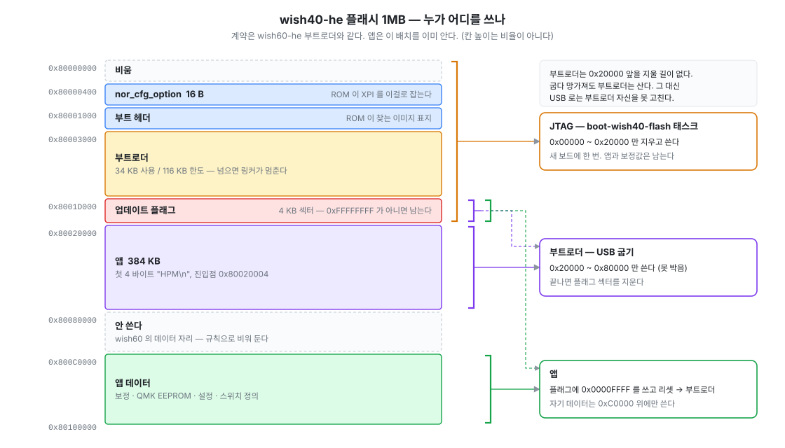
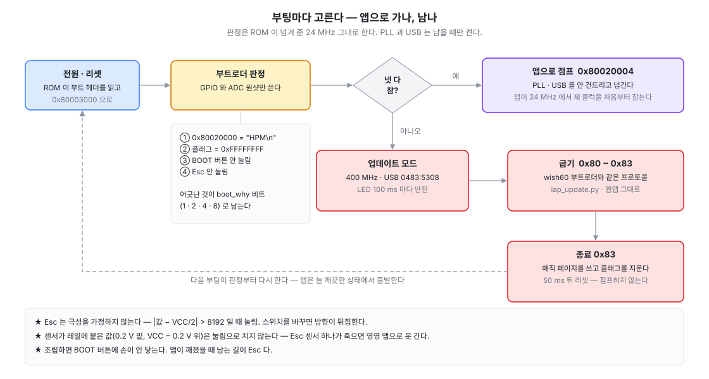
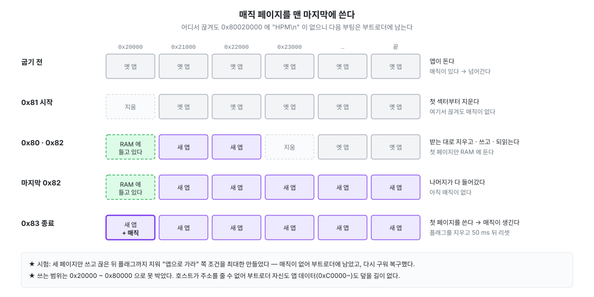

# 19. 부트로더를 직접 만들기 (wish40-he)

> 전체 목차는 [README.md](README.md) 를 본다. 브링업 기록은 [wish40-he.md](wish40-he.md).

wish60 · wish61 은 보드에 들어 있던 부트로더 위에 앱만 얹었다. wish40-he 는 우리가 설계한
보드라 **칩이 비어 있다** — 부트로더부터 우리가 만든다. 소스는 `boot/wish40-he/`, 새 보드에
넣을 이미지는 `boot/wish40-he/bin/wish40-he-boot.bin` 이다.

목표는 하나다. **조립한 뒤에도 USB 하나로 굽고, 망가져도 USB 하나로 살린다.** 케이스에 넣으면
밑면의 택트 스위치 둘(RESET · BOOT)에도, JTAG · BOOT 스트랩 헤더에도 손이 안 닿는다.

---

## 계약은 wish60 부트로더 그대로

새로 정하지 않았다. 앱 · `iap_update.py` · 웹앱이 이미 wish60 의 계약을 안다 — 그대로 맞추면
셋 다 손대지 않아도 된다.



| | |
|---|---|
| 부트로더 | `0x80003000` ~ `0x8001D000` 앞 (34KB 사용 / 116KB 한도) |
| 업데이트 플래그 | `0x8001D000` — `0xFFFFFFFF` 가 아니면 부트로더에 남는다. 앱은 `0x0000FFFF` 를 쓴다 |
| 앱 | `0x80020000` — 첫 4바이트 `"HPM\n"`, 진입점 `0x80020004`, 384KB |
| 굽기 | HID usage page `0xFF53`, 64B, 명령 `0x80` ~ `0x83` (9편) |

다른 것은 **USB ID 하나**다. 앱은 `0483:5307`, 부트로더는 `0483:5308`.

★ wish60 부트로더의 `534B:4102` 를 빌려 쓰지 않았다. 같은 ID 면 **앱이 깨져 부트로더에 머문
  보드를 웹앱이 wish60 인지 wish40 인지 못 가린다** — 엉뚱한 보드의 펌웨어를 권하게 된다.
  그 ID 는 wish60 보드에 원래 들어 있던 부트로더의 것이기도 하다. `0x5306` 은 다른 저장소의
  보드가 이미 쓰고 있어 한 칸씩 밀었다 — 새 PID 는 여러 저장소를 뒤져 고른다.

★ 부트로더가 `0x1D000` 을 넘으면 앱이 플래그를 쓰는 순간 부트로더 끝자락이 지워진다. 링커
  스크립트로 크기를 묶어 넘으면 빌드가 멈추게 했다. XIP 원본(`HPM5361_FLASH_XIP.ld`)에서
  크기 한 줄만 바꿔 빌드 때 만든다 — 사본을 두면 두 벌이 갈라진다.

## 부팅마다 고른다



넷이 **다** 참이어야 앱으로 간다. 어긋난 것은 `boot_why` 비트로 남아 JTAG 으로 읽힌다.

| 비트 | 조건 | 쓰임 |
|---|---|---|
| 1 | `0x80020000` 이 `"HPM\n"` 이 아니다 | 빈 칩, 굽다 끊긴 앱 |
| 2 | 플래그가 `0xFFFFFFFF` 가 아니다 | 앱이 진입을 요청했다 (웹앱 · `iap_update.py` 가 쓰는 길) |
| 4 | BOOT 버튼(PA30)이 눌렸다 | 조립 전 복구 |
| 8 | **Esc 를 누른 채 꽂았다** | **조립 뒤 복구** — 손이 닿는 것이 키뿐이다 |

### ★ 넘어가는 길에서는 PLL 도 USB 도 안 건드린다

판정은 ROM 이 넘겨 준 24MHz 그대로, GPIO 와 ADC 원샷만으로 한다.

앱의 `board_init_clock()` 은 "CPU 가 24MHz 면 프리셋부터" 를 전제로 PLL 을 잡는다. 부트로더가
PLL 을 400MHz 로 올려 두고 넘기면, 앱은 **자기를 먹이고 있는 PLL 을 다시 설정**하게 된다.
켜 둔 USB 도 앱에 재열거 문제를 남긴다 — wish60 에서 부트로더가 켜 둔 주변장치 때문에 인계
정리를 한참 했다 (1편).

그래서 업데이트 모드에서 나갈 때는 **점프하지 않고 리셋한다.** 다음 부팅이 판정부터 다시 하고
깨끗한 상태로 넘어간다. 앱이 400MHz 를 제대로 잡는 것을 확인했다.

### ★ Esc 는 극성을 가정하지 않고, 고장 난 센서를 눌림으로 치지 않는다

Esc = MUX 주소 0 · ADC ch11 (MAG0). 이 보드는 누르면 값이 오르지만 스위치를 바꾸면 뒤집힌다.
그래서 **VCC/2 에서 얼마나 벗어났나**만 본다 — `|값 − 32768| > 8192`. 휴지는 1400, 바닥은 16600
카운트쯤이라 그 가운데다.

센서가 레일에 붙은 값(0.2V 밑, VCC − 0.2V 위)은 눌림으로 안 친다. TMAG5253 의 선형 출력 범위
밖이라 센서가 아니다. 그걸 눌림으로 보면 **Esc 센서 하나가 죽는 순간 영영 앱으로 못 간다.**

### ★ 버스를 무한히 잡는 접근은 쓰지 않는다

ADC 원샷을 `wait_dis = true`(완료 비트 폴링)로 읽는다. 브링업 시험 코드에서 원샷 모드를 안
켠 채 "변환 끝까지 버스를 잡는" 읽기를 했더니 첫 읽기가 영영 안 돌아왔고, 그 상태의 코어는
**디버그 정지조차 못 받았다** (wish40-he.md). 부트로더에서 그러면 USB 로도 JTAG 으로도 못 살린다.

## 굽기 — 어디서 끊겨도 다시 산다



조립한 보드는 택트 스위치에 손이 안 닿는다. 반쯤 쓴 앱으로 넘어가 죽으면 남는 길이 Esc 하나뿐이다.
그래서 **매직이 든 첫 페이지를 맨 마지막에 쓴다.**

1. 시작(`0x81`) — 첫 섹터부터 지운다. 매직이 사라진다
2. 데이터(`0x80` · `0x82`) — 첫 페이지는 RAM 에 들고 있고, 나머지는 받는 대로 지우고 · 쓰고 ·
   **D-cache 를 무효화한 뒤 되읽어** 확인한다 (ROM API 는 D-cache 를 안 건드린다 — 3편)
3. 종료(`0x83`) — 첫 페이지를 쓴다. 이때 비로소 매직이 생긴다. 플래그를 지우고 50ms 뒤 리셋

쓰는 범위는 `0x20000` ~ `0x80000` 으로 못 박았다. 호스트가 주소를 줄 수 없으므로 부트로더
자신도, 앱의 저장 데이터(`0xC0000~`)도 덮을 길이 없다. 그 대가로 **USB 로는 부트로더를 못
고친다** — 조립한 보드의 부트로더는 그대로 간다.

종료만 보내면(시작 없이) 굽지 않고 플래그만 지우고 리셋한다 — "들어갔다 나오기" 다.

## USB — HID 하나

wish60 부트로더는 키보드 · VIA · 마우스까지 인터페이스 넷을 띄웠지만 호스트 도구는 셋 다 안
본다. `iap_update.py` 는 usage page 로, 웹앱은 VID/PID + usage page 로 찾는다. 쓰지 않는
인터페이스는 틀릴 자리만 늘리므로 **`0xFF53` 하나만** 둔다 (64B, 리포트 ID 없음).

명령 처리는 메인 루프에서 한다. 플래시 소거는 인터럽트를 막고 수십 ms 를 쓰는데, ISR 안에서
하면 그동안 USB 가 통째로 멈춘다. OUT 을 받으면 **재무장하지 않고 들고만 있다.** 컨트롤러가
다음 OUT 을 NAK 하므로 호스트는 그냥 기다린다 (16편의 흐름제어와 같다).

### ★ LQFP64 에는 VBUS 핀이 없다

처음 구웠을 때 펌웨어는 멀쩡히 도는데 호스트에 아무것도 안 보였다. 재 보니 OTGSC 가
`0x00203021` — **BSV(세션 유효) 0, BSE(세션 종료) 1.** 컨트롤러가 VBUS 를 못 봐서 D+ 풀업을
안 건 것이다.

wish60 · wish61 은 LQFP100 이라 VBUS 핀으로 감지가 된다. LQFP64 는 그 핀이 없어
`usb_phy_using_internal_vbus()` 로 PHY 에 "VBUS 유효" 를 직접 세워야 한다. 버스 전원 장치라
케이블을 뽑으면 전원이 같이 꺼지므로 잃는 것이 없다. **본 펌웨어(board.c)도 같은 줄이 있어야
한다** — 넣었다.

★ 브링업 회로 시험에서는 USB 를 일부러 뺐었다. 극성(PA24 = D+)만 회로도와 대조했고 실제
  동작은 부트로더가 처음이었다.

### ★ 종료 응답이 절반쯤 사라졌다 — 타이머 버그

플래그를 세운 채 구우면 `iap_update.py` 가 "응답 없음 (cmd 0x83)" 을 냈다 (8번 중 6번). 리셋
지연을 3초로 늘리면 19ms 에 정상으로 왔다 — 지연이 짧아서가 아니었다.

부팅마다 RAM 이 지워지므로 **아무도 안 쓰는 AHB SRAM(0xF0400000)에 시각을 남겨 리셋 뒤에
읽었다.** 실패한 회차는 종료 처리 0.1ms 뒤에 리셋하고 있었다.

```c
done_ms = nowMs() | 1;                    /* "0 이 아님" 을 시각에 섞었다 */
if (nowMs() - done_ms >= 50) reset();     /* now 가 짝수면 now − (now+1) = 0xFFFFFFFF */
```

"예약됨" 을 따로 두고 고친 뒤 8/8. **표시를 값에 섞지 않는다.**

## 이미지와 굽기

새 보드에는 VSCode 태스크 `boot-wish40-flash` 하나다. 저장소의 이미지를 JTAG 으로 굽는다.
`0x80000000` ~ `0x80020000` 만 지우므로 쓰던 보드에 다시 넣어도 앱과 보정값은 남는다.
그다음부터는 USB 다 — `python3 tools/iap_update.py build/wish40-he/wish40-he-tag.bin`. 앱이 돌고
있으면 도구가 HID 로 부트로더에 넣는다.

부트로더를 고쳤으면 시험한 뒤 `boot-wish40-release` 로 저장소 이미지를 갈아 끼운다. **시험을
통과한 판만** 넣는다 — 빌드할 때마다 바뀌면 어느 판을 시험했는지 모른다 (CLAUDE.md).

★ 이미지는 objcopy 가 아니라 `tools/boot_image.py` 가 ELF 의 LOAD 세그먼트에서 만든다.

  - objcopy 는 가장 낮은 섹션(`0x80000400` 의 nor_cfg)부터 시작해서 `0x80000000` 에 쓰면 전부
    0x400 씩 밀린다
  - 섹션 사이 빈틈을 0x00 으로 채운다. `--gap-fill 0xff` 를 주자 이번에는 LMA 가 0 근처인
    섹션까지 이어 채워 **2GB 짜리 파일**이 됐다 — 크기 검사가 걸러 냈다
  - ELF 를 OpenOCD 로 그대로 구우면 `0x0` ~ `0x400` 에 **ELF 헤더가 쓰인다.** 링커가 헤더를 첫
    세그먼트에 넣어서다. ROM 은 `0x400` · `0x1000` 만 보므로 무해했지만 이미지는 그 자리를 0xFF
    로 둔다

### JTAG 이 안 붙을 때

코어가 버스 접근 하나에 묶이면 정지 요청을 못 받아 `init` 의 examine 부터 실패한다
(`Unable to halt`). `reset halt` 는 examine 이 끝나야 쓸 수 있어 소용없다. **DMI 를 날로 써서
리셋과 정지 요청을 같이 건다** — ROM 에서 멈추고 examine 이 통과한다. `tools/bringup_wish40.py
--rescue` 가 이 절차다.

```
irscan hpm5361.cpu 0x11;  drscan hpm5361.cpu 2 0x2 32 <dmcontrol> 7 0x10
0x00000001 -> 0x80000003 -> 0x80000001 -> arp_examine -> reset halt
```

## 시험한 것

시험 이미지(브링업)를 앱 계약으로 링크해(`-DBRINGUP_AS_APP=ON`) 썼다. 그다음 본 펌웨어로도
여러 번 구웠다.

| 시험 | 결과 |
|---|---|
| 빈 칩 → 부트로더에 남는다 | `boot_why = 1`, `0483:5308` High Speed 로 열거 |
| `iap_update.py` 로 굽기 | 앱이 400MHz 로 돈다, 플래시가 이미지와 일치 |
| 플래그 → 남음 → 굽기 → 플래그 지워짐 | **8/8** |
| 세 페이지 쓰고 끊음 (플래그도 지움) | 매직이 없어 부트로더에 남는다. 다시 구우면 복구 |
| Esc 를 누른 채 꽂기 | `boot_why = 8` (Esc 하나), 그때 값 49564 |
| BOOT 버튼을 누른 채 꽂기 | `boot_why = 4` (버튼 하나) |
| 종료(0x83)만 보내기 | 굽지 않고 리셋 → 앱 |
| 앱의 HID 진입 명령 → 굽기 → 앱 | USB 만으로 한 번에 (조립한 보드) |

## 남은 것

- **굽기가 느리다** — 169KB 에 6.5초 (wish60 은 87KB 에 0.9초). HID 폴링 간격을 1ms 로 둬서 64B
  리포트 하나에 1ms 씩 걸리는 것으로 보인다. **조립한 보드는 부트로더를 못 바꾸므로** 두 번째
  보드부터 들어간다
- **USB 시리얼이 `0001`** — 앱은 칩 UUID 로 바꿨는데 부트로더는 아직이다. 위와 같이 두 번째
  보드에서 시험한 뒤 이미지를 갈아 끼운다
